

  

  
  
  


  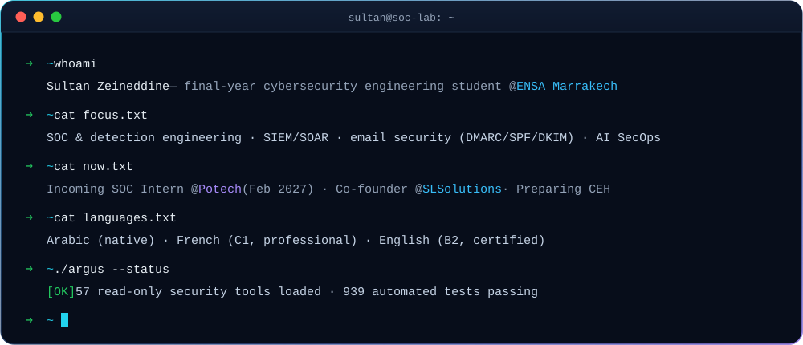


  


  <a href="https://github.com/Sultan-zd/mcp-entra-secops"></a>
  <a href="https://github.com/Sultan-zd/DMARC-Project"></a>

  <a href="https://github.com/Sultan-zd/archi_0_trust-main"></a>
  <a href="https://github.com/Sultan-zd/WebVulnScanner"></a>

  <a href="https://github.com/Sultan-zd/SecureStorageInspector"></a>
  <a href="https://github.com/Sultan-zd/Projet_PFS"></a>

  More projects: <a href="https://github.com/Sultan-zd/projet-devsecops">DevSecOps Security Lab</a> · <a href="https://github.com/Sultan-zd/vaultdex.web">VaultDex</a> · <a href="https://github.com/Sultan-zd/Sec2All">Sec2All</a> · <a href="https://github.com/Sultan-zd/solostock-b2b">SoloStock B2B</a>


  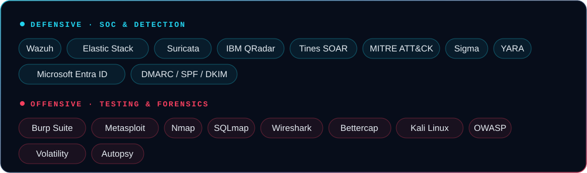


   
  


  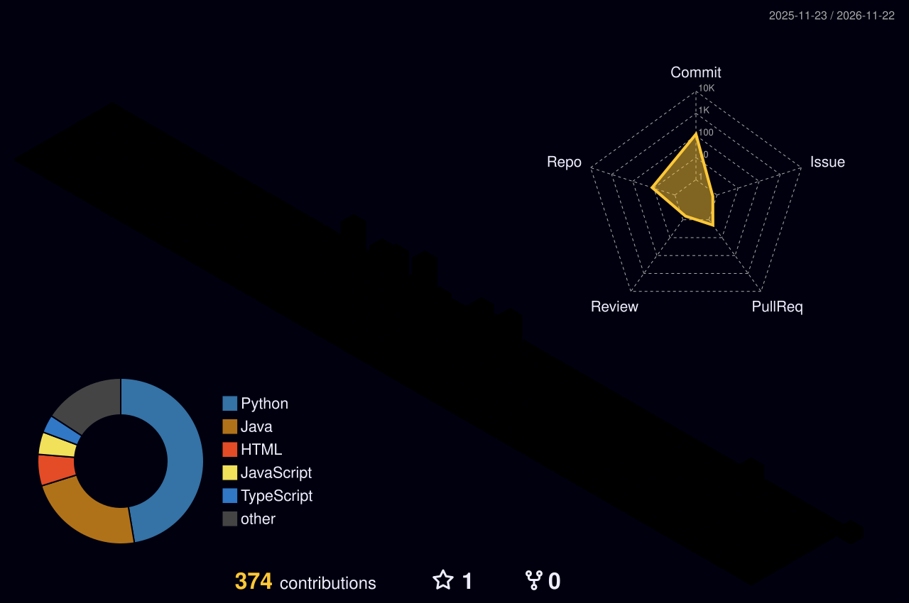

  <picture>
    <source media="(prefers-color-scheme: dark)" srcset="./profile-snake/github-snake-dark.svg" />
    <source media="(prefers-color-scheme: light)" srcset="./profile-snake/github-snake.svg" />
    
  </picture>

  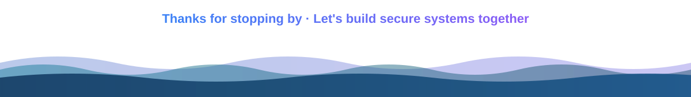

